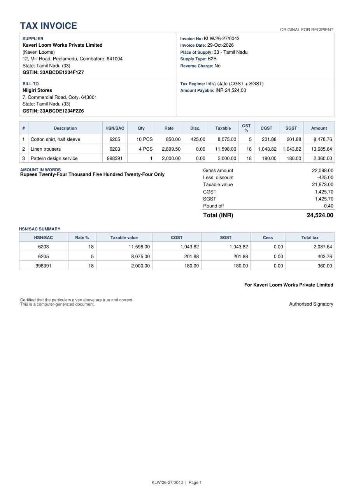

# gst-invoice-api

**A Spring Boot REST API that turns line items into Indian GST tax invoices: CGST/SGST/UTGST or IGST, cess, round-off, amount in words, HSN summary, an A4 PDF, and the e-invoice (IRP) JSON payload.**

[](https://github.com/Pirainuthal/gst-invoice-api/actions/workflows/ci.yml)
[](LICENSE)
[](https://openjdk.org/projects/jdk/17/)
[](https://spring.io/projects/spring-boot)

<p align="center"></p>

The image above is page 1 of [`docs/sample-invoice.pdf`](docs/sample-invoice.pdf), produced by `POST /api/v1/invoices/pdf` from [`examples/b2b-intra-state.json`](examples/b2b-intra-state.json).

## Features

- **Tax engine** written with `BigDecimal` and explicit `HALF_UP` rounding. It never uses `double`.
- **Intra- vs inter-state** decided from the seller's state and the place of supply. Supplies to an SEZ and exports are always IGST (IGST Act s. 7(5)).
- **UTGST** label for union territories without a legislature (Chandigarh, Ladakh, Lakshadweep, A&N Islands, DNH & DD, Other Territory).
- **Zero-rated supplies**: export or SEZ, with payment of IGST or under LUT/bond. The PDF prints the matching rule 46 endorsement.
- **Line discounts**, **ad-valorem and specific cess**, **round-off to the nearest rupee** (can be turned off), and the **amount in words** in the Indian system (lakh/crore).
- **HSN/SAC-wise tax summary**, grouped by code and rate as in GSTR-1 table 12.
- **GSTIN validation**: format, state code, mod-36 check character, and consistency with the party's state.
- **Rate validation** against the current slabs, with warnings when a rate is unusual for the invoice date (for example 12% after 22-Sep-2025).
- **A4 PDF** rendered with OpenPDF, with Indian digit grouping (`12,34,567.00`) and automatic pagination.
- **e-invoice schema 1.1 payload** (`Version`, `TranDtls`, `DocDtls`, `SellerDtls`, `BuyerDtls`, `ItemList`, `ValDtls`). It is checked against the IRP rules this API can check offline.
- **Errors in RFC 9457 / 7807 `application/problem+json`** format, with a field-level `errors` array.
- **Swagger UI** through springdoc-openapi, plus an actuator health endpoint.

> **Scope:** `POST /api/v1/invoices/e-invoice` **generates the JSON request payload only.** It does not authenticate with or submit to the Invoice Registration Portal. It does not obtain an IRN, an acknowledgement number or a signed QR code. Sending the payload to the IRP, directly or through a GSP, is up to you.

## Quick start

Requirements: JDK 17+. The Maven wrapper is included.

```bash
./mvnw spring-boot:run
# Swagger UI:  http://localhost:8080/swagger-ui.html
# OpenAPI:     http://localhost:8080/v3/api-docs
# Health:      http://localhost:8080/actuator/health
```

Or build a jar:

```bash
./mvnw -B verify          # format check + 95 tests + coverage gate
java -jar target/gst-invoice-api-0.1.0-SNAPSHOT.jar
```

### Docker

The `Dockerfile` has two stages: a Maven build stage and a slim JRE runtime that runs as a non-root user with Spring Boot's layered jar.

```bash
docker build -t gst-invoice-api .
docker run --rm -p 8080:8080 gst-invoice-api
```

`docker-compose.yml`:

```yaml
services:
  gst-invoice-api:
    build: .
    image: gst-invoice-api:latest
    ports:
      - "8080:8080"
    environment:
      # Optional: override the accepted GST rates
      GST_RATES_ALLOWED: "0,0.1,0.25,1.5,3,5,12,18,28,40"
    restart: unless-stopped
```

## Usage

Every example below was run against the real application. The outputs are copied verbatim, with some fields trimmed using `jq`. All parties and GSTINs in this repository are fictional, though their check characters are valid.

### Calculate an inter-state invoice (Tamil Nadu → Karnataka)

```bash
curl -s -X POST localhost:8080/api/v1/invoices/calculate \
  -H 'Content-Type: application/json' \
  -d @examples/b2b-inter-state.json \
  | jq '{taxRegime, placeOfSupply, line1: .lines[0], totals, amountInWords, warnings}'
```

```json
{
  "taxRegime": "INTER_STATE",
  "placeOfSupply": {
    "code": "29",
    "name": "Karnataka"
  },
  "line1": {
    "lineNo": 1,
    "description": "Cotton shirt, half sleeve",
    "hsnCode": "6205",
    "service": false,
    "quantity": 10,
    "unit": "PCS",
    "unitPrice": 850,
    "grossAmount": 8500.00,
    "discountPercent": 5,
    "discountAmount": 425.00,
    "taxableValue": 8075.00,
    "gstRate": 5,
    "cgstRate": 0,
    "cgstAmount": 0.00,
    "sgstRate": 0,
    "sgstAmount": 0.00,
    "igstRate": 5,
    "igstAmount": 403.75,
    "cessRate": 0,
    "cessAmount": 0.00,
    "cessNonAdvolAmount": 0.00,
    "lineTotal": 8478.75
  },
  "totals": {
    "grossAmount": 22098.00,
    "discountAmount": 425.00,
    "taxableValue": 21673.00,
    "cgstAmount": 0.00,
    "sgstAmount": 0.00,
    "igstAmount": 2851.39,
    "cessAmount": 0.00,
    "totalTax": 2851.39,
    "totalBeforeRoundOff": 24524.39,
    "roundOff": -0.39,
    "grandTotal": 24524.00
  },
  "amountInWords": "Rupees Twenty-Four Thousand Five Hundred Twenty-Four Only",
  "warnings": []
}
```

### The same items within Tamil Nadu (CGST + SGST)

```bash
curl -s -X POST localhost:8080/api/v1/invoices/calculate \
  -H 'Content-Type: application/json' -d @examples/b2b-intra-state.json \
  | jq '{taxRegime, stateTaxLabel, hsnSummary: [.hsnSummary[] | {hsnCode, gstRate, taxableValue, cgstAmount, sgstAmount, totalTax}], totals: (.totals | {taxableValue, cgstAmount, sgstAmount, totalTax, roundOff, grandTotal})}'
```

```json
{
  "taxRegime": "INTRA_STATE",
  "stateTaxLabel": "SGST",
  "hsnSummary": [
    { "hsnCode": "6203", "gstRate": 18, "taxableValue": 11598.00, "cgstAmount": 1043.82, "sgstAmount": 1043.82, "totalTax": 2087.64 },
    { "hsnCode": "6205", "gstRate": 5, "taxableValue": 8075.00, "cgstAmount": 201.88, "sgstAmount": 201.88, "totalTax": 403.76 },
    { "hsnCode": "998391", "gstRate": 18, "taxableValue": 2000.00, "cgstAmount": 180.00, "sgstAmount": 180.00, "totalTax": 360.00 }
  ],
  "totals": {
    "taxableValue": 21673.00,
    "cgstAmount": 1425.70,
    "sgstAmount": 1425.70,
    "totalTax": 2851.40,
    "roundOff": -0.40,
    "grandTotal": 24524.00
  }
}
```

Total tax is ₹2,851.40 here against ₹2,851.39 as IGST. The 5% line produces 201.875 for each of CGST and SGST, and each half rounds up separately. That one-paisa difference is expected; see [Design notes](#design-notes).

### Export under LUT (zero-rated, no tax charged)

```bash
curl -s -X POST localhost:8080/api/v1/invoices/calculate \
  -H 'Content-Type: application/json' -d @examples/export-under-lut.json \
  | jq '{supplyType, placeOfSupply, taxRegime, totals: (.totals|{taxableValue, igstAmount, grandTotal}), warnings}'
```

```json
{
  "supplyType": "EXPORT_WITHOUT_PAYMENT",
  "placeOfSupply": {
    "code": "96",
    "name": "Other Country"
  },
  "taxRegime": "INTER_STATE",
  "totals": {
    "taxableValue": 225000.00,
    "igstAmount": 0.00,
    "grandTotal": 225000.00
  },
  "warnings": [
    "Zero-rated supply under LUT/bond: no tax is charged. Print the LUT/bond reference and the endorsement required by rule 46 on the invoice."
  ]
}
```

### Render the PDF

```bash
curl -s -X POST localhost:8080/api/v1/invoices/pdf \
  -H 'Content-Type: application/json' -d @examples/b2b-intra-state.json -o invoice.pdf -D -
```

```
HTTP/1.1 200
Content-Disposition: inline; filename="KLW_26-27_0043.pdf"
Content-Type: application/pdf
```

### Build the e-invoice payload

```bash
curl -s -X POST localhost:8080/api/v1/invoices/e-invoice \
  -H 'Content-Type: application/json' -d @examples/b2b-inter-state.json \
  | jq '.ItemList |= [.[0]]'      # first item only, for brevity
```

```json
{
  "Version": "1.1",
  "TranDtls": { "TaxSch": "GST", "SupTyp": "B2B", "RegRev": "N", "IgstOnIntra": "N" },
  "DocDtls": { "Typ": "INV", "No": "KLW/26-27/0042", "Dt": "29/10/2026" },
  "SellerDtls": {
    "Gstin": "33ABCDE1234F1Z7", "LglNm": "Kaveri Loom Works Private Limited", "TrdNm": "Kaveri Looms",
    "Addr1": "12, Mill Road", "Addr2": "Peelamedu", "Loc": "Coimbatore", "Pin": 641004, "Stcd": "33",
    "Em": "accounts@example.com"
  },
  "BuyerDtls": {
    "Gstin": "29PQRSX5678K1ZU", "LglNm": "Deccan Retail LLP", "Pos": "29",
    "Addr1": "4th Cross, Indiranagar", "Loc": "Bengaluru", "Pin": 560038, "Stcd": "29"
  },
  "ItemList": [
    {
      "SlNo": "1", "PrdDesc": "Cotton shirt, half sleeve", "IsServc": "N", "HsnCd": "6205",
      "Qty": 10, "Unit": "PCS", "UnitPrice": 850, "TotAmt": 8500.00, "Discount": 425.00,
      "AssAmt": 8075.00, "GstRt": 5, "IgstAmt": 403.75, "CgstAmt": 0.00, "SgstAmt": 0.00,
      "CesRt": 0, "CesAmt": 0.00, "CesNonAdvlAmt": 0.00, "StateCesRt": 0, "StateCesAmt": 0.00,
      "StateCesNonAdvlAmt": 0.00, "OthChrg": 0.00, "TotItemVal": 8478.75
    }
  ],
  "ValDtls": {
    "AssVal": 21673.00, "CgstVal": 0.00, "SgstVal": 0.00, "IgstVal": 2851.39, "CesVal": 0.00,
    "StCesVal": 0.00, "Discount": 0.00, "OthChrg": 0.00, "RndOffAmt": -0.39, "TotInvVal": 24524.00
  }
}
```

(The JSON was reflowed to save space. The field names, order and values are unchanged.)

### Validate a GSTIN offline

```bash
curl -s localhost:8080/api/v1/gstin/33abcde1234f1z7 | jq -c .
curl -s localhost:8080/api/v1/gstin/33ABCDE1234F1Z8 | jq -c .
```

```json
{"gstin":"33ABCDE1234F1Z7","valid":true,"stateCode":"33","stateName":"Tamil Nadu","pan":"ABCDE1234F","problems":[]}
{"gstin":"33ABCDE1234F1Z8","valid":false,"problems":["GSTIN checksum mismatch: last character should be '7' but is '8'"]}
```

### Errors (`application/problem+json`)

Field validation fails with **400**:

```bash
jq '.seller.gstin="33ABCDE1234F1Z8" | .items[0].discountPercent=105' examples/b2b-inter-state.json \
  | curl -s -i -X POST localhost:8080/api/v1/invoices/calculate -H 'Content-Type: application/json' -d @-
```

```
HTTP/1.1 400
Content-Type: application/problem+json

{"type":"https://github.com/Pirainuthal/gst-invoice-api/problems/validation","title":"Invalid request","status":400,"detail":"Request validation failed","instance":"/api/v1/invoices/calculate","errors":[{"field":"items[0].discountPercent","message":"must be less than or equal to 100"},{"field":"seller.gstin","message":"GSTIN checksum mismatch: last character should be '7' but is '8'"}]}
```

A GST business rule is broken (**422**):

```json
{
  "type": "https://github.com/Pirainuthal/gst-invoice-api/problems/gst-rule",
  "title": "GST rule violation",
  "status": 422,
  "detail": "The invoice violates GST rules",
  "instance": "/api/v1/invoices/calculate",
  "errors": [
    {
      "field": "items[2].gstRate",
      "message": "7% is not a GST rate; allowed: [0, 0.1, 0.25, 1.5, 3, 5, 12, 18, 28, 40]"
    }
  ]
}
```

A legal but unusual rate does not fail. It produces a warning instead, for example with `gstRate: 12` on a 2026 invoice:

```json
["12% GST was removed for most goods and services from 22-Sep-2025 (items moved to 5% or 18%); confirm the HSN/SAC still attracts 12%."]
```

## API reference

| Method | Path | Returns |
|---|---|---|
| `POST` | `/api/v1/invoices/calculate` | Calculated invoice (JSON) |
| `POST` | `/api/v1/invoices/pdf` | A4 tax invoice (`application/pdf`) |
| `POST` | `/api/v1/invoices/e-invoice` | e-invoice schema 1.1 request payload (JSON) |
| `GET` | `/api/v1/gstin/{gstin}` | Offline GSTIN check |
| `GET` | `/swagger-ui.html`, `/v3/api-docs` | Interactive docs / OpenAPI 3 |
| `GET` | `/actuator/health` | Liveness |

The three `POST` endpoints accept the same `InvoiceRequest` body.

### `InvoiceRequest`

| Field | Type | Required | Notes |
|---|---|---|---|
| `invoiceNumber` | string | yes | 1–16 characters: letters, digits, `/`, `-` (CGST rule 46). The e-invoice also rejects a leading `0`, `/` or `-`. |
| `invoiceDate` | `yyyy-MM-dd` | yes | Parsed strictly: an impossible date such as `2026-02-30` is a 400, not silently moved to 28 February. |
| `documentType` | `INV` \| `CRN` \| `DBN` | no | Default `INV`. Sets the PDF title (Tax Invoice / Credit Note / Debit Note). |
| `supplyType` | `REGULAR` \| `SEZ_WITH_PAYMENT` \| `SEZ_WITHOUT_PAYMENT` \| `EXPORT_WITH_PAYMENT` \| `EXPORT_WITHOUT_PAYMENT` | no | Default `REGULAR`. |
| `seller` | `Party` | yes | `gstin` is required for the seller. |
| `buyer` | `Party` | yes | Omit `gstin` for an unregistered (B2C) buyer. |
| `placeOfSupply` | 2-digit code | no | Defaults to `buyer.stateCode`, or `96` for exports. |
| `items` | `LineItem[]` | yes | 1–1000 lines. |
| `roundOff` | boolean | no | Default `true`: round the grand total to the nearest rupee. |

### `Party`

`legalName` (required), `tradeName`, `gstin`, `stateCode` (required, 2 digits), `address1`, `address2`, `location`, `pincode` (6 digits), `phone`, `email`. Address, location and PIN are optional for calculation but **required for the e-invoice**. The exception is an overseas buyer, whose PIN is set to `999999`.

### `LineItem`

| Field | Type | Required | Notes |
|---|---|---|---|
| `description` | string | yes | ≤ 300 characters |
| `hsnCode` | string | yes | 4, 6 or 8 digits. Codes starting with `99` are SAC (services). |
| `quantity` | decimal | yes | > 0, up to 3 decimals |
| `unit` | UQC | goods: yes | e.g. `NOS`, `PCS`, `KGS`. The e-invoice checks it against the UQC list. |
| `unitPrice` | decimal | yes | ≥ 0, before GST, up to 3 decimals |
| `discountPercent` | decimal | no | 0–100 |
| `gstRate` | decimal | yes | Combined rate. Must be in `gst.rates.allowed`. |
| `cessRate` | decimal | no | Ad-valorem cess % |
| `cessPerUnit` | decimal | no | Specific cess in ₹ per unit (`CesNonAdvlAmt`) |

### Response highlights

- `taxRegime`: `INTRA_STATE` or `INTER_STATE`.
- `stateTaxLabel`: `SGST` or `UTGST`; omitted for inter-state supplies.
- `lines[]`: gross, discount, taxable value, each tax rate and amount, cess, line total.
- `hsnSummary[]`: one row per (HSN/SAC, rate).
- `totals`: gross, discount, taxable, CGST, SGST, IGST, cess, total tax, total before round-off, round-off, grand total.
- `amountInWords` and `warnings[]`.

Null fields are omitted from JSON responses.

## Configuration

| Property | Default | Meaning |
|---|---|---|
| `gst.rates.allowed` | `0, 0.1, 0.25, 1.5, 3, 5, 12, 18, 28, 40` | Accepted combined GST rates (%). Set it with `GST_RATES_ALLOWED` in Docker. |
| `server.port` | `8080` | |

## Design notes

**Rounding policy.** Money has scale 2 and rounds `HALF_UP`, applied at these points:

1. gross = qty × unit price, rounded to paise
2. discount = gross × discount% ÷ 100, rounded to paise; taxable = gross − discount
3. each tax component (CGST, SGST/UTGST, IGST, cess) is computed **per line** from the taxable value and rounded to paise. CGST and SGST are each computed at half the rate, independently.
4. invoice totals are sums of the rounded line amounts, so the lines always add up to the totals
5. the grand total rounds to the nearest rupee, and the difference is reported as `roundOff`

Because of step 3, CGST + SGST can differ from the equivalent IGST by a paisa (see the intra-state example). Most accounting systems behave the same way: each half is its own ledger amount. Section 170 of the CGST Act requires rounding to the nearest rupee only for amounts *payable to the government* (tax, interest, penalty). The invoice round-off here is the usual commercial practice, and it stays inside the IRP's `RndOffAmt` limit of ±99.99.

**Which tax applies.** If the seller's state code equals the place of supply, the invoice is intra-state: CGST + SGST, or CGST + UTGST in a union territory without a legislature. Otherwise it is IGST. Supplies to SEZ units and developers, and exports, are always IGST whatever the states (IGST Act s. 7(5)). With `*_WITHOUT_PAYMENT` (LUT/bond), the rate is shown and the tax is zero.

**Rates.** The slab structure changed with effect from 22 September 2025 (Notification 9/2025-Central Tax (Rate)). Its schedules are 5%, 18%, 40%, 3%, 0.25%, 1.5%, and 28% retained for specified tobacco items. To these the default list adds 0% (nil/exempt), 0.1% (supplies to merchant exporters) and 12% (needed for invoices and credit notes dated before 22-Sep-2025). Rates outside the list are rejected. Rates that are valid but unusual for the invoice date produce a warning. **The API does not map HSN codes to rates.** You must supply the correct rate for each HSN.

**Validation layers.** Bean Validation (Jakarta) checks shape and format and returns **400**. GST business rules (state codes, GSTIN-to-state consistency, buyer GSTIN different from the seller's, rate slabs, export/SEZ preconditions, a unit for goods lines) return **422**. The e-invoice endpoint adds the schema 1.1 checks it can make offline, also as **422**: B2B only, addresses and PIN, document-number format, UQC master codes, 3-character minimums for names, trade names, address line 2, location and descriptions, no `"` in text fields, and the schema's e-mail pattern. Both use `ProblemDetail` with an `errors[]` array of `{field, message}`.

**GSTIN check character.** Each of the first 14 characters is mapped to its index in `0-9A-Z` and weighted 1 or 2 alternately. Each product contributes `product / 36 + product % 36`, and the check character is `(36 − sum mod 36) mod 36`. The implementation is tested against a synthetic example, `27ABCDE1234F1Z0` (placeholder PAN ABCDE1234F). Only the PAN-based layout of regular taxpayers is accepted.

**PDF.** OpenPDF with the standard Helvetica font, so the PDF needs no font files. Helvetica only covers Windows-1252 (Latin) text: it has no ₹ glyph, so amounts are labelled `INR`, and names, addresses or descriptions in an Indian script are rejected with a **422** that names the field, because OpenPDF would otherwise drop those characters without any error. Dates and headings are formatted with a fixed locale, so the output does not depend on the server's default locale. Tables repeat their header rows on new pages, and every page has an "invoice no | page n" footer.

**Project layout**

```
src/main/java/io/github/pirainuthal/gstinvoice/
├── api/        request records, enums, @ValidGstin constraint
├── calc/       GstCalculator (pure tax engine), result records, rate catalogue
├── domain/     GSTIN, state codes, HSN, UQC, Indian number words & grouping
├── einvoice/   schema 1.1 records + mapper
├── pdf/        OpenPDF renderer
├── web/        controllers + problem-details advice
└── config/     OpenAPI metadata
```

## Testing

```bash
./mvnw -B verify
```

This runs Spotless (google-java-format) in check mode, compiles with `-Xlint:all,-processing,-serial -Werror`, runs **95 JUnit 5 tests**, and enforces a JaCoCo line-coverage gate of 85%. Current coverage is about 99% of lines and 91% of branches.

| Suite | What it covers |
|---|---|
| `GstCalculatorTest` | intra/inter-state, UTGST, explicit place of supply, SEZ, exports with/without payment, nil-rated, discounts, half-up rounding both ways, round-off off, 0.1% split, cess (ad-valorem + specific), multiple rates & HSN summary, every business-rule violation, rate advisories |
| `EInvoiceMapperTest` | B2B/SEZ/export/credit-note mapping, schema field names and order, `URP`/`96`/`999999` for exports, B2C rejection, address/UQC/document-number checks, schema text rules (minimum lengths, no `"`, e-mail pattern) |
| `InvoicePdfRendererTest` | text extracted with PDFBox: title, GSTINs, totals, words, export endorsement, cess column, pagination, credit-note labels, locale independence, rejection of text Helvetica cannot print |
| `GstinTest`, `IndianNumberWordsTest`, `IndianNumberFormatTest`, `ReferenceDataTest` | checksum, layout and state errors, lakh/crore words and grouping, state/HSN/UQC reference data |
| `InvoiceApiTest` (MockMvc, full context) | all endpoints, problem+json for 400/422/malformed JSON, strict date parsing, BigDecimal scale in JSON, OpenAPI document |

Format the code with `./mvnw spotless:apply`.

## Sources

- e-invoice schema and validations: NIC e-invoice API sandbox, [Generate IRN](https://einv-apisandbox.nic.in/version1.03/generate-irn.html) (schema version 1.1, mandatory fields, ±₹1 tolerance, `RndOffAmt` limits, export `URP`/`96`/`999999`, document-number format)
- Rate rationalisation from 22-Sep-2025: Notification No. 9/2025-Central Tax (Rate), dated 17-Sep-2025, published on the [CBIC GST portal](https://cbic-gst.gov.in/). See also the [Taxscan summary](https://www.taxscan.in/top-stories/cbic-issues-gst-rate-notification-new-gst-rates-effective-from-22-september-2025-1432884).
- GSTIN check character: [python-stdnum `stdnum.in_.gstin`](https://arthurdejong.org/python-stdnum/doc/stdnum.in_.gstin), which implements the same algorithm
- Tax-invoice contents and the export/SEZ endorsement: CGST Rules 2017, rule 46
- SEZ supplies and exports as inter-state supplies: IGST Act 2017, s. 7(5); UTGST in union territories without a legislature: UTGST Act 2017

## Limitations and roadmap

This is a calculation and formatting tool. It is **not** a certified GSP/ASP and has not been audited. Have a tax professional review your configuration before you use it for real filings.

Not yet supported:

- [ ] Reverse charge (`RegRev = Y`) and `IgstOnIntra` cases
- [ ] Invoice-level discounts and other charges (`ValDtls.Discount` / `OthChrg` are always 0)
- [ ] State cess, and dispatch/ship-to, payment, reference, export (`ExpDtls`) and e-way bill blocks of the e-invoice
- [ ] B2C dynamic QR code
- [ ] Multi-currency export invoices (`TotInvValFc`)
- [ ] An HSN → rate lookup table (today the caller supplies the rate)
- [ ] A Unicode font, to print `₹` and Indian-language text (today such text is rejected by the PDF endpoint)
- [ ] Credit/debit notes: reference to the original invoice number and date (CGST rule 53)
- [ ] IRP checks that depend on the date or on live data: the document-date window (the sandbox page currently accepts dates from 01/04/2025), the ±₹1 tolerance, PIN-to-state matching and GSTIN status

## License

[MIT](LICENSE) © 2026 [Pirainuthal S](https://github.com/Pirainuthal)

The PDF library [OpenPDF](https://github.com/LibrePDF/OpenPDF) is dual-licensed under LGPL-2.1 and MPL-2.0. It is used unmodified as a library dependency.
